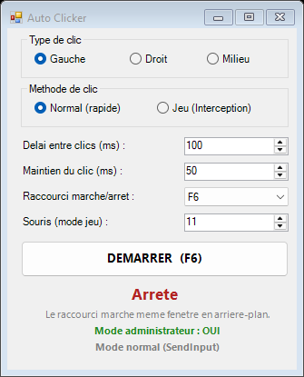
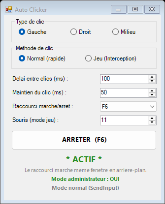
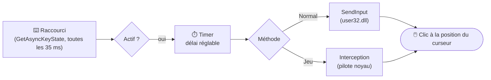

<div align="center">



<br/>


**Un auto-clicker léger pour Windows : une petite fenêtre, un raccourci clavier, et c'est parti.**
Il a même un **mode Jeu** pour les jeux qui ignorent les clics simulés classiques.

</div>

---

## 📸 Aperçu

<div align="center">
<table>
  <tr>
    <td align="center"><br/><sub><b>À l'arrêt</b></sub></td>
    <td align="center"><br/><sub><b>En marche</b></sub></td>
  </tr>
</table>
</div>

## ✨ Fonctionnalités

- 🖱️ **Clic gauche, droit ou milieu**
- ⏱️ **Délai réglable** entre les clics, de 1 ms à 10 min (`100` ms = 10 clics/s)
- 👇 **Maintien du clic** réglable, pour les jeux qui lisent la souris image par image
- ⌨️ **Raccourci global** marche/arrêt : F1 à F12, Arrêt défil, Pause, Inser, pavé numérique… (**F6** par défaut). Il fonctionne même quand la fenêtre est en arrière-plan.
- 🎮 **Deux méthodes de clic** :
  - **Normal (rapide)** avec `SendInput`, pour le bureau, les applis et les jeux 2D ou fenêtrés
  - **Jeu (Interception)** : simule une **vraie souris matérielle** pour les jeux en *Raw Input*
- 📌 Fenêtre **toujours au premier plan**, sans console noire
- 🛡️ Se relance **automatiquement en administrateur** (nécessaire pour cliquer dans les jeux)
- 📜 **100 % lisible** : tout le programme tient dans [`AutoClicker.ps1`](AutoClicker.ps1)

## 🚀 Utilisation

1. Télécharge le dépôt (**Code → Download ZIP**) et décompresse-le.
2. **Double-clique sur `AutoClicker.bat`**, puis accepte la fenêtre UAC (**Oui**).
3. Choisis le **type de clic**, la **méthode**, le **délai** et le **raccourci**.
4. Place ta souris, puis appuie sur le **raccourci** (ou sur **DÉMARRER**).
5. Appuie à nouveau sur le raccourci (ou sur **ARRÊTER**) pour stopper.

> 💡 **Astuce** : clic droit sur `AutoClicker.bat` → **Envoyer vers → Bureau (créer un raccourci)** pour le lancer rapidement.

> Si **SmartScreen** affiche un avertissement au premier lancement : **Informations complémentaires → Exécuter quand même**. Le script est en clair, tu peux le lire entièrement avant.

## 🎮 Mode Jeu (Interception)

Beaucoup de jeux lisent la souris à très bas niveau (*Raw Input*) et **ignorent les clics simulés** par les auto-clickers classiques, même lancés en administrateur. Le mode Jeu utilise le pilote open-source [**Interception**](https://github.com/oblitum/Interception), qui fait passer les clics pour ceux d'une souris physique.

**Installation du pilote (une seule fois) :**

1. Télécharge la dernière release sur [github.com/oblitum/Interception/releases](https://github.com/oblitum/Interception/releases).
2. Dans une **invite de commandes administrateur**, lance :
   ```bat
   "command line installer\install-interception.exe" /install
   ```
3. **Redémarre le PC** : c'est obligatoire pour qu'un pilote système se charge.
4. La bibliothèque `interception.dll` est déjà fournie à côté du script.

**Ensuite, dans l'app :**

- Choisis **« Jeu (Interception) »**. En bas, l'indicateur doit afficher **« pilote ACTIF »** en vert.
- Règle **Maintien du clic** vers **50 ms** (monte à 80–100 si le jeu ne réagit pas).
- Préfère une touche peu utilisée par les jeux : **Arrêt défil** ou **Pause**.
- Si rien ne se passe, change **Souris (mode jeu)** de 11 à 12.
- Si le plein écran pose problème, passe le jeu en **fenêtré sans bordure**.

**Désinstaller le pilote** (invite de commandes administrateur, puis redémarrage) :

```bat
"command line installer\install-interception.exe" /uninstall
```

## ⚠️ Avertissement

Les jeux **en ligne ou compétitifs** utilisent souvent un **anti-triche** (Vanguard, EAC, BattlEye…). Un auto-clicker, et surtout un pilote comme Interception, peut y être **détecté** et entraîner un **bannissement**. Réserve-le aux jeux **solo / hors ligne** ou à ceux qui l'autorisent.

## 🗂️ Fichiers

| Fichier | Rôle |
|---|---|
| [`AutoClicker.bat`](AutoClicker.bat) | Lanceur : double-clic, sans console visible |
| [`AutoClicker.ps1`](AutoClicker.ps1) | Le programme (PowerShell + WinForms + P/Invoke `SendInput` / Interception) |
| `interception.dll` | Bibliothèque cliente du pilote [Interception](https://github.com/oblitum/Interception) (mode Jeu) |

## ⚙️ Comment ça marche



---

<div align="center">
<sub>🖱️ Fait par <a href="https://github.com/ThomasGJack">ThomasGJack</a> · Pilote Interception © <a href="https://github.com/oblitum">oblitum</a></sub>
</div>
